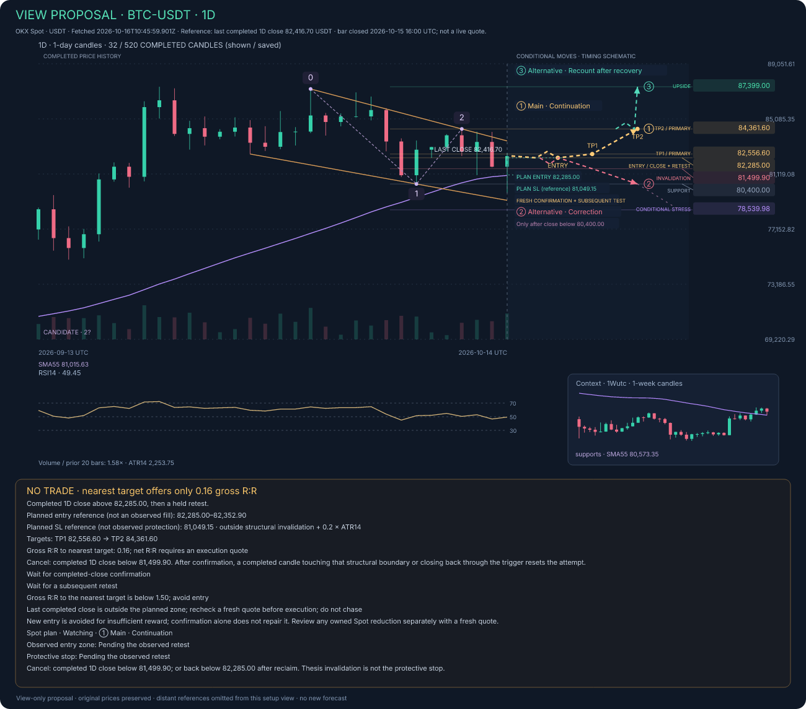
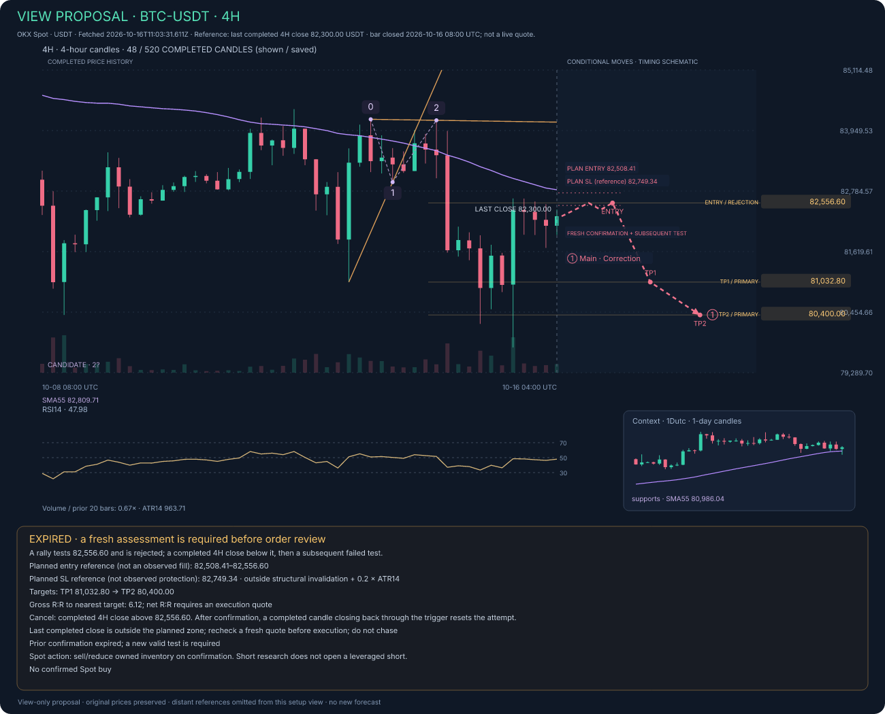
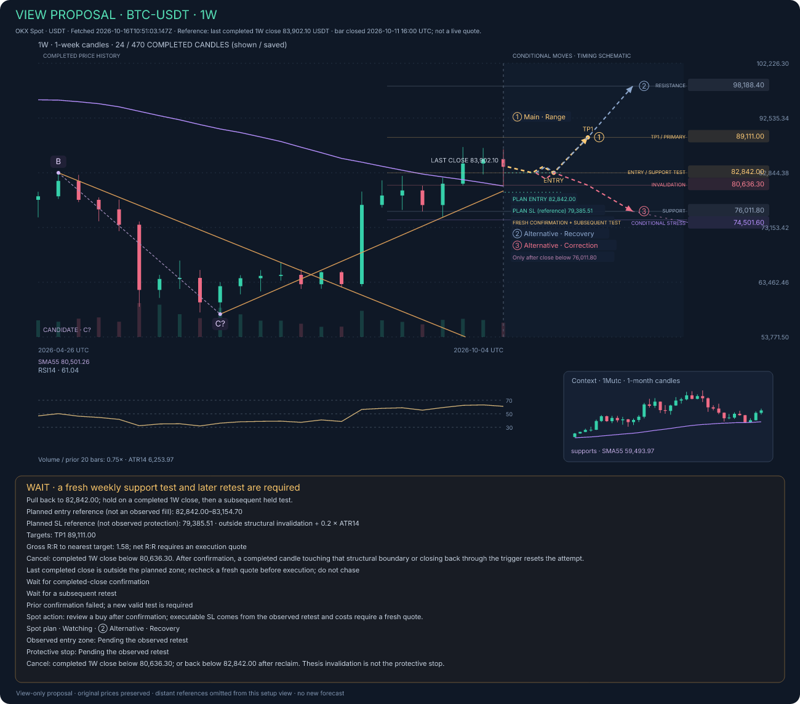

# BTC reports: stop placement, WAIT states and distant targets — 16 October 2026

The supplied four TXT files and four JPG chart exports were checked against their existing saved reports and compared with the October 14, 14:33–14:37 UTC snapshots. This is an investigation and implementation plan, not a new market forecast. Times below are UTC unless Samara time is explicitly shown.

The earlier checks established arithmetic and rendering consistency too narrowly. This investigation identifies a production readiness gap, inconsistent target filtering and an uncalibrated risk policy that accurate arithmetic alone did not resolve. Prompt wording changes cannot fix those problems.

**1. What is correct, and what changed**

The supplied prices reproduce the saved map. Independent recalculation agrees for the primary SMA series, Wilder RSI14, ATR14 and primary gross reward/risk. The main failures are selection, eligibility, presentation and execution workflow.

| Timeframe | October 14 primary plan | October 16 primary plan | Meaning |
| --- | --- | --- | --- |
| 1H | Short reference 82,603.38–82,627.18; SL 82,722.40; gross R:R 2.74 | Upper-edge range rejection/sell research: 82,298.40–82,319.60; SL 82,513.02; TP1 81,933.50; gross R:R 1.70 | A new range plan, with an expired prior rejection. Its 1.70 is before costs. |
| 4H | Short reference 83,490.27–83,530.10; SL 83,689.40; gross R:R 1.61 | Short reference 82,508.41–82,556.60; SL 82,749.34; targets 81,032.80 and 80,400.00; gross R:R 6.12 | The next mapped support is farther below the planned entry. The reference stop remains only 0.25 ATR away. The attempt has expired. |
| 1D | Support-pullback long 82,556.60–82,665.62; SL 81,848.94; TP1 87,399.00; gross R:R 5.80 | Reclaim long 82,285.00–82,352.90; SL 81,049.15; targets 82,556.60 and 84,361.60; gross R:R 0.16 | New nearby resistance is now the first obstacle. The old 87,399 target cannot still be treated as the nearest target. This geometry fails the entry threshold. |
| 1W | Long reference 82,842.00–83,154.70; SL 79,385.51; TP1 89,111.00; gross R:R 1.58 | Identical prices and gross R:R | No additional weekly candle has completed. The same prior failure and missing new confirmation remain. |

Weekly data still ends at the candle completed October 11 at 16:00, although the report was fetched October 16. The next weekly candle completes October 18 at 16:00, or 20:00 Samara time. An intraday rebound cannot satisfy a weekly completed-candle rule. A weekly analysis can inform an intraday trade, but its context timeframe and the actual entry-confirmation timeframe must be named separately.

The local Elliott candidate also changes with new confirmed pivots: daily moves from a larger upward 1–5/A hypothesis to a newer downward partial 1–2 hypothesis. The new daily anchors are 87,238.30 → 80,400.00 → 84,361.60. The selector favors the most recent confirmed pattern, with ATR filtering used to break ties. This is not proof that every larger structure reversed. The report should explain the new pivot and change of local scale instead of leaving the reader to interpret a new count as an unexplained strategic reversal.

**2. Are the daily and weekly stops too close?**

The code uses the same reference formula on every timeframe:

`Long planned SL = structural invalidation − 0.2 × ATR14`

`Short planned SL = structural invalidation + 0.2 × ATR14`

The 0.2 ATR is an additional buffer. It is not the entire entry-to-stop distance. For example, the daily invalidation is 81,499.90 and the extra buffer is 450.75, producing 81,049.15. The weekly invalidation is 80,636.30 and the buffer is 1,250.79, producing 79,385.51.

| Timeframe | Worst planned entry | Planned SL reference | Entry-to-stop distance | Distance / entry | Distance / ATR14 |
| --- | ---: | ---: | ---: | ---: | ---: |
| 1H short | 82,298.40 | 82,513.02 | 214.62 | 0.26% | 0.51 ATR |
| 4H short | 82,508.41 | 82,749.34 | 240.93 | 0.29% | 0.25 ATR |
| 1D long | 82,352.90 | 81,049.15 | 1,303.75 | 1.58% | 0.58 ATR |
| 1W long | 83,154.70 | 79,385.51 | 3,769.19 | 4.53% | 0.60 ATR |

The daily reference is actually wider than October 14: 1.58% versus 0.99%. Weekly is unchanged. Their small visual separation is amplified by the chart's broad vertical scale, especially the daily 126,200 reference. Nevertheless, both stops are inside one ATR of the entry, and 4H is substantially tighter. There is no demonstrated calibration connecting this fixed policy to the intended holding period, stop-out frequency or trade expectancy.

ATR measures the price range of the selected bars; it is not a probability of loss and does not prove that a particular stop is safe. [Fidelity's ATR guide](https://www.fidelity.com/learning-center/trading-investing/technical-analysis/technical-indicator-guide/atr) describes volatility-sensitive stop placement, but does not validate PULSE's 0.2-ATR buffer or prescribe one universal multiplier for all trading styles.

Today's last daily candle also traded down to 79,775.10, below both 81,499.90 and the planned SL reference. Its close recovered to 82,416.70. It cannot qualify as a clean support test under the current rules merely because it closed above 82,285.00. That is why “already above the trigger” does not imply a valid confirmation. The report should display this disqualification explicitly.

These are future planning references. There is no active observed daily or weekly protective stop to copy. Current observed buy protection is created only after a valid retest, using that retest's low minus its ATR buffer. That can produce a different stop from the planning card, while the card retains the earlier reference and R:R. The presentation needs a clear reconciliation between planning risk and observed-entry risk.

The appropriate change is to derive stop placement from the observed structure and chosen holding/entry timeframe, display its percentage and ATR distance, and validate its noise tolerance. Candidate buffer/minimum-distance policies should be compared with walk-forward data, including adverse excursion, stop-outs, fees and drawdown. Increasing every stop blindly to 1.5 or 2 ATR would not establish a better strategy. Tightening a stop or skipping the nearest obstacle merely to manufacture an attractive R:R is also unacceptable.

**3. Why the daily 126,200 level appeared**

The chart label is **126,200**, approximately **53.12% above** the saved daily close of 82,416.70, or **19.43 daily ATR** away. It is an alternative recount target, not the primary daily TP1. The primary targets are 82,556.60 and 84,361.60.

Its origin is deterministic: the highest high in the saved 520 daily candles, from the candle opened **October 6, 2025 at 16:00**. Its anchor ID is `range-1759766400000-high`. It is a historical market reference, not a number invented by Grok.

The construction in `prepareGlobalReport` adds the archive's high and low to the level set. The ordinary upside-target list applies a four-ATR proximity filter. The recount branch then selects the next two entries from the full overhead list. Its distance check is applied to the recount's trigger, **not to each resulting target**. A trigger at 84,361.60 therefore admits both 87,399.00 and the distant 126,200.00 high. A sparse overhead level list makes the jump look like an unobstructed route without establishing that intermediate resistance is absent.

The same defect appears in the 4H downside stress path: **62,268.50**, from the archive-low candle opened August 1, 2026 at 16:00, is **24.34% below** the saved 82,300 close and **20.79 four-hour ATR** away. The stress selector simply takes the next lower available level without applying the nearby-target rule.

Historical extremes can be useful context. Their being genuine prices does not justify drawing them as nearby setup objectives with an ordinary future arrow. There is no evidence here for a time-to-arrival prediction, nor a basis for saying BTC can never revisit those levels. The defect is their classification and presentation within this report horizon.

The PNG renderer also includes every visible path/reference level in its minimum/maximum price calculation. The distant daily high and 4H low therefore stretch the axis and compress candles, entry, SL and realistic targets. This is an application selection/scaling issue. TradingView already supports controlling autoscaling through [its series autoscale API](https://tradingview.github.io/lightweight-charts/docs/api/interfaces/SeriesOptionsCommon#autoscaleinfoprovider); another charting product would not choose a sound target policy for us.

**4. Why WAIT does not reliably become GO**

Three distinct decisions are currently mixed together: market direction, technical qualification, and executable order readiness. They need separate visible states.

There is a confirmed production integration gap. `runPreparedSpotAnalysis` calls `prepareGlobalReport` with market, tier, language and context, without execution costs. `evaluateGlobalSetup` requires non-null costs before it can return `ready`. No other production caller supplies this parameter or re-evaluates the setup with a fresh quote. A report does not know trade size or route at generation time, so inserting a guessed fee or zero would be the wrong repair.

The gap was reproduced offline with a synthetic technically qualified market. Direct evaluation with an explicitly supplied 5-basis-point cost estimate returns Ready. The normal production-shaped pipeline, with the provider mocked and the same candles, returns Watching with `execution_costs` missing. This demonstrates a workflow defect rather than an inference from a few WAIT examples.

Saved reports are immutable snapshots. Reopening them does not fetch new candles or call the model. Their market conditions cannot advance simply because time passes. Existing manual Market/Limit review is available, and actually observed, unexpired protection can be copied for explicit manual review. Missing protection must be entered by the user. Those actions do not upgrade a stale or incomplete report to Ready.

Today's attempt-specific blockers are concrete:

- **1H:** a previous rejection and test exist, but the window ended October 16 at **11:00**. The report was fetched at 11:06. The saved close is outside the 82,298.40–82,319.60 reference zone. Its 1.70 gross R:R is not a measured net R:R.
- **4H:** the prior window ended October 16 at **04:00**, about seven hours before the report. A new test and assessment are needed. There is no mapped observed Spot buy setup on this snapshot.
- **1D:** there is no qualified reclaim/retest, and the nearest-target gross R:R is **0.16**. This is a **No trade at these references** result. Waiting for confirmation alone cannot fix it.
- **1W:** the previous support attempt failed, no new weekly support confirmation/retest is observed, and there is no newer completed weekly bar. Net reward is still unknown.

Expiry is calculated from the confirmation candle's **opening** timestamp plus four timeframe intervals. That is only three intervals after its close became observable. The implementation needs separate deadlines for waiting for a retest and for entering after a completed retest. Those clocks should start from observable completed-bar times and be shown in the report. They must not silently renew stale attempts.

The planned entry band is also very narrow: at most 0.05 ATR, capped further by the first target. Today's widths are 21.20 (1H), 48.19 (4H), 67.90 (daily) and 312.70 (weekly). A valid retest can close outside that generic band. Execution eligibility should use the actual observed retest, a fresh quote, risk boundaries and a net-reward-constrained entry range, rather than treating one historical completed close as a current quote.

The upper-edge 1H range plan is labeled short because price is closer to the upper range boundary; its market narrative also describes a range rotating upward from support. That is a possible range framework, but the selected upper-edge rejection plan must be named directly so a reader can distinguish it from buying the lower edge.

**5. What a usable transition should mean**

| State shown to the reader | Evidence and next step |
| --- | --- |
| No trade | A hard blocker such as inadequate reward or invalid geometry. State what must change structurally; do not imply that one more confirming candle is enough. |
| Waiting for confirmation | Give the precise timeframe, level and valid-test rule. Show any disqualified prior candle and why it failed. |
| Waiting for retest | Identify the qualifying confirmation, required subsequent test and deadline. |
| Technical setup valid — check quote | A completed valid test, observed entry/protection and fresh technical validity exist. Costs/route/amount still need review. |
| Ready for order review | Fresh entry quote, protection, net reward, amount, route, balance and deadlines pass. This permits reviewing a Market/Limit ticket; it does not place an order. |
| Expired / invalidated | Show the event and time, remove current protection eligibility, and explain the new attempt required. |

The practical sequence is: valid structure and sufficient reward → qualifying completed confirmation → later valid retest → fresh size-specific quote and observed stop → acceptable net reward and risk amount → Market/Limit review with TP/SL → explicit wallet approval. A validated wave count is supporting context, not an independent requirement to force a trade.

Bearish short research must remain distinct from selling owned Spot inventory. The current app can prepare an owned-inventory sell; that does not open a leveraged short. Hypothetical short TP/SL should not be presented as automatically executable Spot-short protection.

Risk should be expressed in cash as well as percentages. A sizing aid can use `chosen cash-risk budget / (entry-to-stop distance per unit + modeled costs/slippage per unit)`, constrained by balance and route liquidity. The user chooses that budget; the report should not infer an allocation from wallet wealth. A stop trigger does not guarantee its quoted fill price. [FINRA's explanation](https://www.finra.org/investors/insights/stop-orders-factors-consider-during-volatile-markets) illustrates this execution distinction; PULSE must additionally explain its actual onchain/keeper protection, slippage and expiry behavior.

The cost sensitivity is material. Under the existing net-R:R formula, the weekly reference retains net R:R of at least 1.50 only while modeled aggregate costs stay at or below about **14.55 bps**. A hypothetical 20-bps cost produces about **1.47 net R:R**. This is a sensitivity example, not a claim about an actual route's fees. The hourly short research geometry tolerates only about 2.09 bps under the same hypothetical formula; it must not be confused with the profitability of selling inventory already owned.

**6. Proposed report and chart presentation**

For today's daily report, the first card should read approximately:

> **NO TRADE — nearest resistance is too close.**
>
> Planned entry 82,285.00–82,352.90; stop reference 81,049.15. Risk is 1,303.75 per BTC, 1.58% or 0.58 daily ATR. First obstacle is 82,556.60, leaving only 203.70 reward at the worst entry: 0.16 gross R:R.
>
> A new close/retest alone is insufficient. Reassess when valid structure, entry and nearby resistance offer adequate reward. The stop remains a reference until a qualifying retest is observed.

Then show one primary conditional map, one materially relevant alternative if useful, and concise context. Put distant historical references in a separate section with source date, percentage distance and ATR distance. Do not draw a continuous price route to a remote level when intermediate structure is unestablished.

Default to a setup-focused view selected around the relevant recent anchors. Keep a separate Structure/Full history view for the broader wave hypothesis; do not force every old wave anchor into the entry-risk chart. Retain candles, SMA55, volume, the primary plan and clear invalidation. Pro retains RSI, independent context and optional studies. Show the entry-to-SL risk band and its percentage/ATR measurement. Labels for planned versus observed protection must remain distinct.

These view-only examples preserve the original prices and do not re-analyze the market. They illustrate filtering remote references and changing the visible window; they are not the final redesign or trade instructions. The illustrated windows are examples, not validated optimal defaults.

The weekly attachments came from two different saved reports: the image snapshot is **10:51:03.147**, while the TXT's matching narrative is **10:52:36.809**. Their prices and trading map agree. The supplied TXT copies also contain `MSSystem:` relay markers, interrupted numbers and incomplete disclaimer endings; their saved canonical documents have complete endings. This does not establish a document-generation failure. Include a short non-secret report reference and timestamp in filenames and Telegram captions so corresponding TXT/PNG artifacts are easy to identify. Never expose access/recovery tokens.

**7. Implementation order and acceptance criteria**

1. **Correct relevance, statuses and scaling first.** In `packages/analysis/src/globalReport.ts`, apply a shared relevance policy to every primary, alternative, recount and stress endpoint. Four ATR can serve as the existing consistency baseline; it is not an empirical reachability guarantee. Retain remote historical levels as context, preserve the nearest genuine obstacle, and permit fewer scenarios. In domain presentation and charting, show No trade for failed reward, explicit expiry, and stop distance in price/%/ATR. Exclude remote context from setup autoscaling. Acceptance: daily 126,200 and 4H 62,268.50 cannot stretch the setup chart or appear as ordinary local objectives; existing near-term references remain traceable.

2. **Create a fresh technical assessment beside the immutable report.** Add a versioned Recheck setup operation that uses current completed candles against the saved map and returns confirmation/test evidence, disqualifications, expiry and supersession. Avoid a new LLM call merely to check these conditions. A changed map must be identified as a new assessment, not silently overwrite purchased levels. Acceptance: a valid later test can advance the assessment; failed/expired attempts cannot revive from the same failing candle; daily/weekly timing remains correct.

3. **Repair expiry and stop/entry policy together.** In `globalConfirmation.ts`, `globalTradePlan.ts` and `evaluateGlobalSetup`, separate maximum time to observe a retest from entry validity after it closes. Reconcile reference protection with protection calculated from the actual retest. Specify the analysis, confirmation and stop horizons. Use a risk-constrained entry range and record stop provenance, rather than widen/tighten prices to pass a ratio. Compare candidate policies on walk-forward public candles before choosing new defaults. Acceptance: no future information; no zero-duration entry window; no favorable-only target selection; realistic stop distance and costs are included in evaluation.

4. **Connect technical qualification to order review.** In API/UI handoffs, obtain a size- and route-specific current quote and modeled cost budget, verify representation/balance/protection/deadlines, then compute net reward. Expose Technical setup valid separately from Ready for order review. Do not insert default zero costs or accept an untrusted user fee as verified. Preserve Market and Limit choices with observed TP/SL prefilling; manual overrides remain explicitly manual. Acceptance: a production-shaped valid case reaches order review, while missing costs or invalid protection cannot; no order is sent without wallet approval. Owned Spot reductions remain separate from leveraged-short research.

5. **Use the same status facts across app, TXT, PNG, Telegram and MCP.** Generate the eligibility explanation from structured evidence. Let Grok explain the market and conflicts briefly; do not rely on prose to invent execution eligibility. Replace raw keys such as `priceReference`, `state none` and `setup path null` with human descriptions. Quick keeps the concise action/condition and chart; Pro adds context, risk detail and wave/study evidence without creating a competing execution plan. Update the illustrated guide and add artifact references. Acceptance: every channel agrees on side, levels, status, costs and next condition; captions/message budgets and complete TXT documents remain valid.

6. **Validate the full workflow before deployment.** Replay both October 14 and October 16 data, including the remote-level regressions, the 0.16 daily No-trade case, weekly stale-bar behavior and expiring hourly/4H attempts. Add a successful fresh technical assessment plus quoted order-review case, alongside negative tests for low net reward, invalid/stale quotes, absent protection and unsupported short execution. Check mobile/desktop setup and structure views, zoom/all-study preservation, and Telegram caption/chart/document delivery with messages mocked. Preserve old report/schema readability and verify discovery compatibility for any public response changes. Paid/provider/onchain checks, if later needed, require the applicable bounded authorization; they are not part of this investigation.

**8. Evidence and scope**

Key code locations are [planner and setup evaluation](../packages/analysis/src/globalReport.ts), [production generation](../packages/analysis/src/globalGrok.ts), [reference risk model](../packages/domain/src/globalTradePlan.ts), [confirmation and expiry](../packages/domain/src/globalConfirmation.ts), [PNG scaling](../packages/domain/src/globalChart.ts), [report UI](../apps/web/src/GlobalResearchReport.tsx), and [Spot handoff](../apps/web/src/reportTradeHandoff.ts).

Read-only history retrieval matched all four image snapshots and the additional weekly TXT narrative. Offline checks validated prices/indicators/reward arithmetic and reproduced the readiness gap with one mocked provider response. The supplied images and view-only proposals were visually inspected. Raw reports, authentication material and provider prose are excluded from the reusable numeric illustration provenance. Private local investigation artifacts are under `.tmp/btc-oct16-investigation/`; diagram provenance is beside the illustrations.

No new reports were purchased, no live model was called, no Telegram message was sent and no trading transaction was made. Production source files remain unchanged during this planning investigation.
